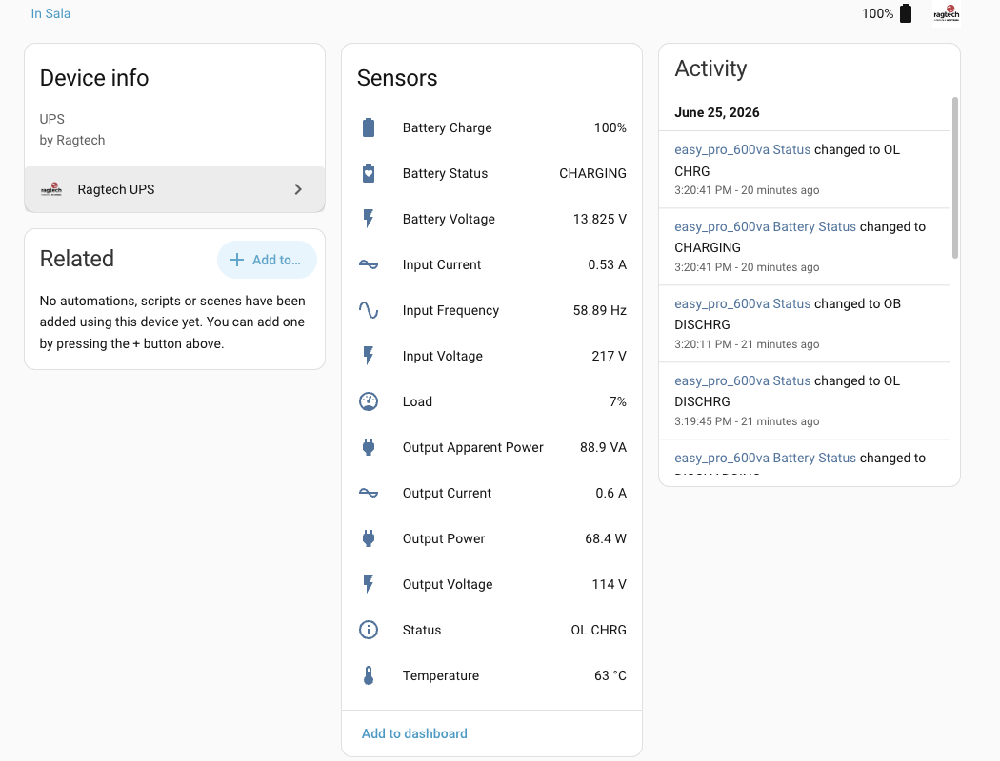

[](https://github.com/carnei-ro/ragtech-hass-integration/releases)
[](https://github.com/carnei-ro/ragtech-hass-integration/blob/main/LICENSE)
[](https://hacs.xyz)

# Ragtech UPS Home Assistant Integration

This custom integration provides monitoring for **Ragtech Uninterruptible Power Supplies (UPS)** connected over a USB/serial port.

It talks to the UPS directly over serial (using [`pyserial`](https://pypi.org/project/pyserial/)), polling it on an interval and exposing the readings as Home Assistant sensors. Unlike the original shell-script based approach, the serial port, baud rate, timeout and polling interval are all **configurable through the UI** — nothing is hardcoded.



### Exposed entities

Every value comes from the UPS's status frame, decoded with the scales and flag positions
Ragtech's own Supervise software uses. The integration only ever sends read requests; it
never writes to the UPS.

If the UPS leaves three polls in a row unanswered, every entity becomes *unavailable*
until it answers again, rather than keeping its last value.

#### Sensors

| Sensor | Unit | Where the value comes from |
| --- | --- | --- |
| Battery Charge | % | Measured by the UPS |
| Battery Voltage | V | Measured: voltage of the whole battery pack (about 13.5 V on 12 V models, 27 V on 24 V models) |
| Battery Status | — | `DISCHARGING` while the UPS says it runs on battery. `CHARGING` is **inferred** (on mains with charge below 100 %), because the UPS has no charging flag. Otherwise `FULL` |
| Input Voltage | V | Measured |
| Output Voltage | V | Measured |
| Output Current | A | Measured, scaled with the unit's calibration register. It is half of what Ragtech's Supervise shows (see below) |
| Output Frequency | Hz | Measured at the inverter, scaled with the unit's calibration registers. It equals the mains frequency while *Synchronised to Mains* is on |
| Output Apparent Power | VA | Calculated: output voltage × output current |
| Output Power | W | One UP 2000 Nitro TI (code `16`): the UPS's load figure × its rated 1400 W, in steps of 14 W. Other models: output voltage × output current, which assumes a power factor of 1 and is an upper bound |
| Temperature | °C | Measured |
| Load | % | Measured by the UPS |
| Status | — | NUT-style, built from the UPS's own flags: `OL` or `OB`, followed by `LB` (battery low), `RB` (battery aged or missing), `OVER` (overload fault) and `ALARM` (any fault) when they apply |

Estimated, not measured:

| Sensor | Unit | How it is estimated |
| --- | --- | --- |
| Input Current | A | Output voltage × output current ÷ (input voltage × an assumed 60 % efficiency) |

Output current and frequency need per-unit calibration values. The integration reads them
from the UPS (registers `0x00F3`, `0x0202` and `0x0203`) when it starts and again after the
UPS has stopped answering. If the UPS refuses or does not answer those reads, or the
values cannot be used (a zero divisor), Output Current and Output Frequency are
*unavailable* rather than guessed, and so are the values calculated from the current:
Output Apparent Power, Input Current and, on models without a rated power, Output
Power. A warning in the log says which read failed, and reloading the integration tries
again.

Supervise shows twice the output current that owners measure. A clamp meter and a
known-load sweep on two One UP Nitro 2000 units, and a metering plug on an NEP 1200,
all read half of the Supervise figure, so the integration publishes that half. Other
models use the same rule untested.

#### Watts, volt-amperes and power factor

A 2000 VA unit is rated 1400 W. That datasheet power factor of 0.7 is the limit of what
the UPS can deliver, not the power factor of the equipment plugged into it, so it cannot
turn a reading in VA into watts.

The UPS reports two things about its output: voltage and current, whose product is the
apparent power (VA), and a load percentage, which Supervise and the front panel show as
"Potência (%)". For the One UP Nitro 2000, an owner reports that Ragtech describes that
percentage as the share of the rated 1400 W in use, and that owner's clamp-meter
readings agree with it, so the integration publishes it as Output Power. Output Power ÷
Output Apparent Power is
then the power factor of the connected equipment. Both readings come from one-byte
registers, so the ratio is only meaningful averaged over time. If Output Power stays
above Output Apparent Power, the current calibration does not fit that unit.

For the other models it is not known what the load percentage refers to, so their
Output Power remains voltage × current.

#### Binary sensors

Each one is a flag the UPS reports itself.

| Binary sensor | On when |
| --- | --- |
| Replace Battery | The UPS judges its battery aged |
| Battery Capacity Reduced | The UPS detected a serious loss of battery capacity |
| Battery Missing | No battery was found at start-up |
| Battery Low | The battery is low |
| On Battery | The UPS runs on battery |
| Mains Absent | There is no mains voltage |
| Mains Voltage Low, Mains Voltage High | Mains is present but out of range |
| Overload Warning | The load is between 90 % and 100 % |
| Over Temperature Fault, Battery Exhausted Fault, Overload Fault, Output Voltage Fault, Battery Voltage Fault, Inverter Fault, Output Short Circuit Fault | The UPS reports that fault |

Diagnostic binary sensors: Battery Discharge Test (a full-discharge test is running),
Battery Capacity Increased, Synchronised to Mains, Vendor Software Attached, Remote
Control, Powerlook and Timer Armed.

#### Diagnostic sensors

| Sensor | Value |
| --- | --- |
| Model Code | Code the UPS reports (see [Supported models](#supported-models)) |
| Firmware Version | Firmware version the UPS reports |
| Battery Capacity Reference | Raw register `0x83`: the capacity the UPS compares the battery against |
| Register 0x80 | Raw settings flags, as hex. Bit 0 is auto-restart, bit 2 high charge current, bit 7 low line sensitivity. Bits 3 and 5 are set on some units, but their meaning is unknown: they are shown, never interpreted |
| Settings Registers | Raw registers `0x80`–`0x86`, as hex |

### Capturing a raw frame

A status frame is 31 bytes: a start byte, then registers `0x80`–`0x9D` (byte N holds
register `0x80 + N − 1`). There are two ways to get one:

- Turn on debug logging and look for the `[get_status] frame:` lines, one per poll:

  ```yaml
  logger:
    logs:
      custom_components.ragtech: debug
  ```

- **Settings → Devices & Services → Ragtech UPS → ⋮ → Download diagnostics.** The file
  holds the last frame, the calibration registers and the last decoded values.

### Supported models

The 20 models of Ragtech's "Easy" family (family 10) share one register map. The UPS
reports a model code, which selects the scales:

| Model codes | Rating | Output | Battery |
| --- | --- | --- | --- |
| `0`, `2`, `4`, `6` | 600, 700, 900, 1200 VA "TI" | 115 V | 12 V |
| `1`, `3`, `5`, `7` | 600, 700, 900, 1200 VA "M2" | 220 V | 12 V |
| `8`, `10`, `12`, `14`, `16`, `18` | 1300, 1400, 1600, 1800, 2000, 2200 VA "TI" | 115 V | 24 V |
| `9`, `11`, `13`, `15`, `17`, `19` | 1300, 1400, 1600, 1800, 2000, 2200 VA "M2" | 220 V | 24 V |

Product names do not map one to one to codes. Code `6` is reported by the Easy Pro and the
Senoidal Puro 1200; code `16` by the One UP 2000 Nitro TI, the NitroUp 2000 and the Easy
2000 TI. Frames from real units were available only for codes `2`, `6`, `16` and `18`; the
other rows follow Ragtech's table untested.

"Save Digital" units (family 13) use the same map with another start byte. The
integration accepts it, but no frame from such a unit has been seen, so this is untested,
and the two extra model codes of that family (`20` and `21`) are not in the table.

During setup the integration probes the UPS once over serial and picks the row matching
the model code the UPS reports. If detection fails (port busy, no answer, unknown model
code) you are asked to pick the model manually. The model can also be changed later in the
options dialog. Frames are decoded with the stored model, whatever code the UPS reports;
the Model Code sensor shows the reported code.

## Installation

The recommended installation method is via [HACS](https://hacs.xyz/):

[](https://my.home-assistant.io/redirect/hacs_repository/?owner=carnei-ro&repository=ragtech-hass-integration&category=integration)

Notes:

- Works on Home Assistant 2025.2 and newer. The manifest lists `pyserial-asyncio-fast` rather
  than `pyserial` itself: Home Assistant 2026.11+ bundles `pyserial` and hassfest rejects custom
  integrations that declare a core dependency, while older releases still need it installed.
  `pyserial-asyncio-fast` is a thin wrapper that depends on `pyserial`, so listing it keeps
  every supported release working.
- HACS only installs the files; you still need to go to `Settings → Devices & Services` and add the integration manually.
- For manual installation (advanced users), copy `custom_components/ragtech` to your Home Assistant `custom_components` directory.

## Configuration

After restarting, add the integration via the **Home Assistant UI**:

1. Go to **Settings → Devices & Services → Add Integration → Ragtech UPS**.

2. Provide the required information:

     - **Name**: Friendly name for your UPS
     - **Serial Port**: Path to the serial device (e.g. `/dev/ttyACM0`)
     - **Baud Rate**: Serial baud rate (default `2560`)
     - **Timeout**: Serial read timeout in seconds (default `5`)
     - **Polling Interval**: How often (in seconds) the UPS is queried (default `30`)

All of these can be changed later through the integration's **Configure** (options) dialog.

> **Note:** Home Assistant must have access to the serial device. When running in a
> container, make sure the device is passed through to the container.

## Changelog

### 0.3.0

Decoding now follows Ragtech's own register map, so several values change:

- **Battery Voltage is now the voltage of the whole battery pack.** 24 V models (codes
  `8`–`19`, such as the One UP 2000 Nitro TI) read about 27 V where they used to read
  about 13.5 V. There is no option to get the halved value back, and history graphs show
  a step at the upgrade.
- Status and Battery Status come from the UPS's own flags. `CHRG` and `DISCHRG` are gone
  from Status, and "input voltage above output voltage" no longer counts as charging.
- New binary sensors for the UPS's flags, among them **Replace Battery**.
- Output Current is scaled with the unit's calibration register and is half of what
  Supervise shows, which is what owners' meters read. Its values change, and with them
  Output Apparent Power, Output Power and Input Current.
- Input Frequency became Output Frequency, which is what the UPS measures, and is scaled
  with the unit's calibration registers. An existing entity keeps its entity id and
  history.
- Output Apparent Power is voltage × current; it used to be 1.3 times that, a factor with
  no measurement behind it.
- Output Power on the One UP 2000 Nitro TI is the UPS's load figure × its rated 1400 W.
  On other models it keeps its formula (voltage × current) and is now documented as an
  upper bound.
- The Easy Pro (code `6`) reads input voltage from the same register as every other
  model.
- All 20 models of the family are supported, and the start byte of "Save Digital" units
  is accepted.
- Entities become unavailable after three unanswered polls. They used to keep their last
  values for as long as the UPS stayed silent.
- If the UPS does not answer while Home Assistant starts, the setup is retried
  automatically. It used to load without entities until the integration was reloaded.
- New diagnostic sensors show the raw registers, the model code and the firmware version.
  The raw frame is logged at debug level and included in the diagnostics download.

## Credits

The decoding follows the register map of Ragtech's Supervise software. Earlier releases
were based on reverse engineering of the Ragtech serial output, calibrated against a
multimeter and the official Ragtech app.

Heavily inspired by [this thread](https://community.home-assistant.io/t/home-assistant-ragtech-nobreak-easy-pro-ups-monitoring/678828/55)
